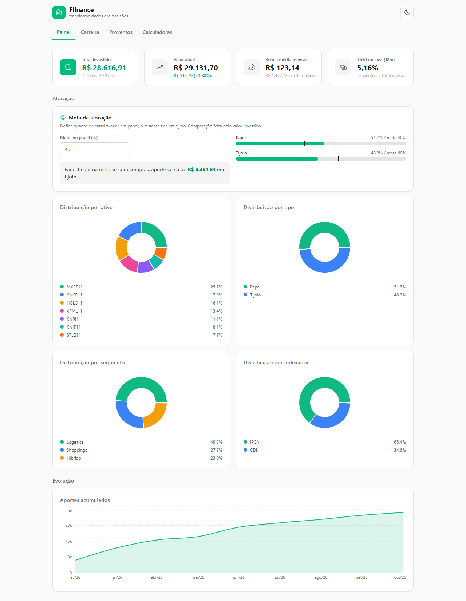
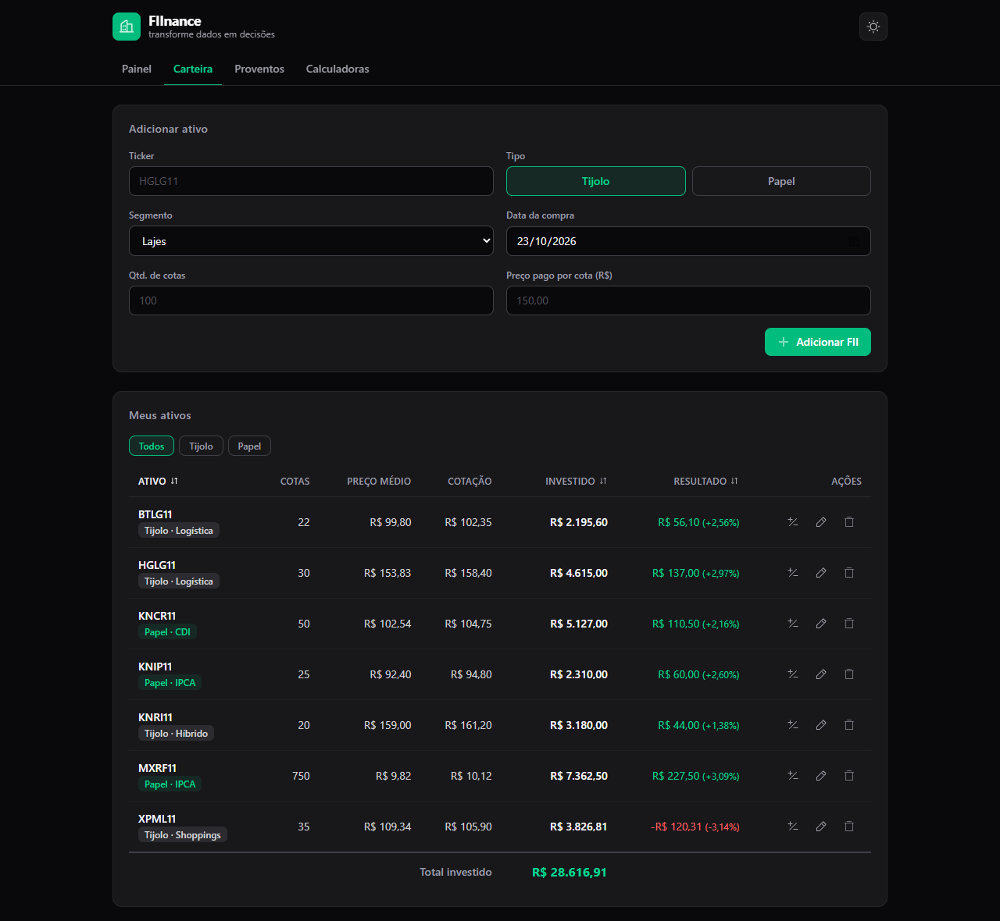
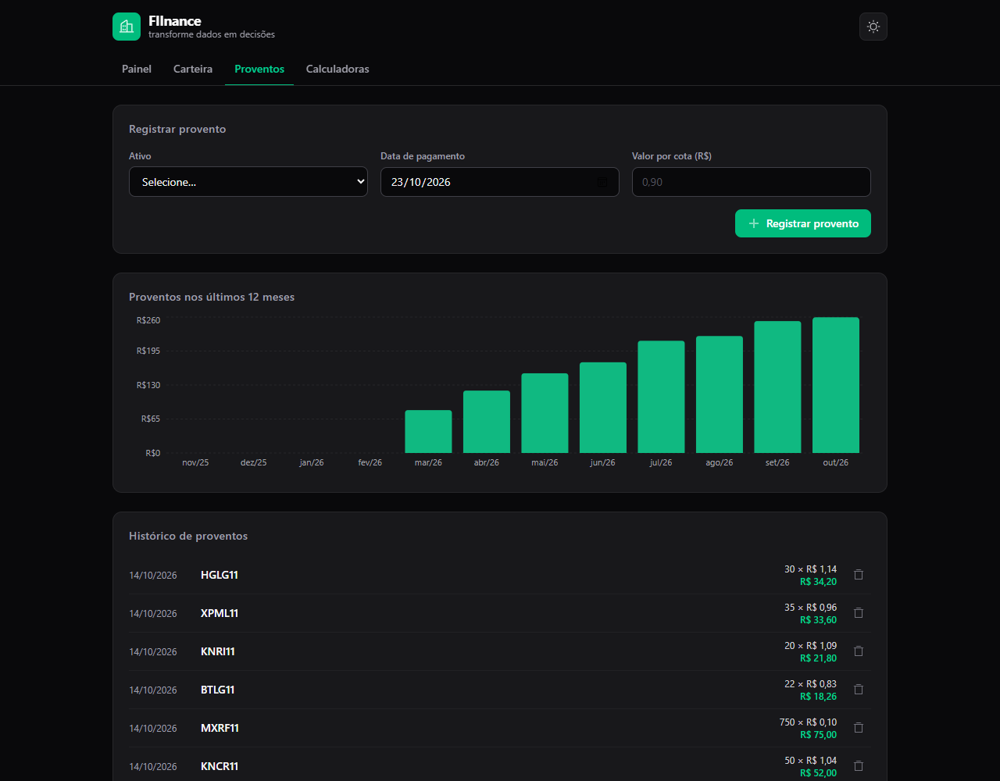
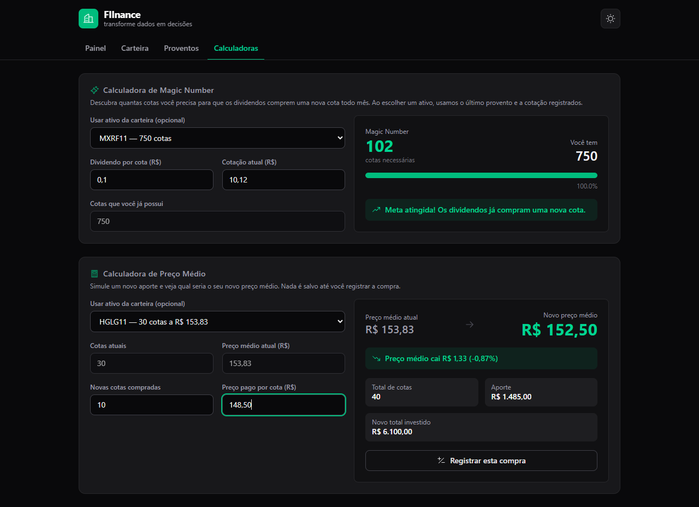
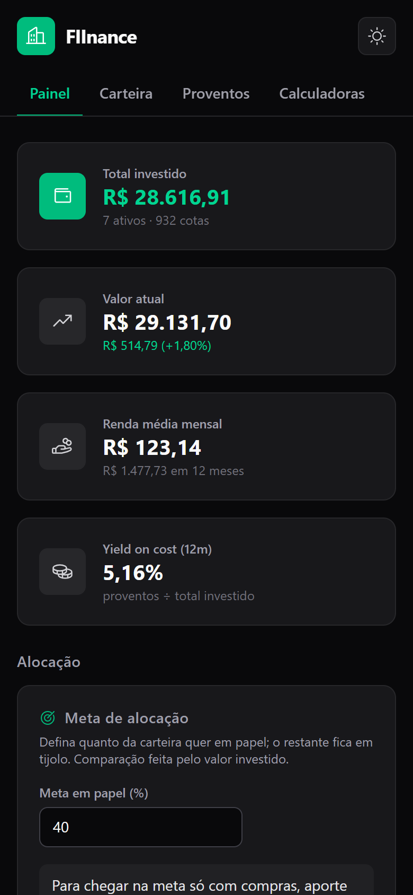
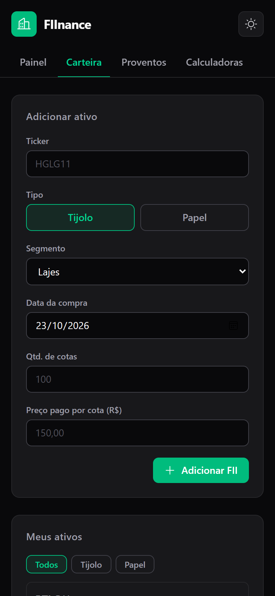

<div align="center">


# FIInance

**Transforme dados em decisões.**<br />
Acompanhe sua carteira de Fundos Imobiliários: preço médio, proventos, meta de alocação e calculadoras, tudo no navegador, sem cadastro.

<br />

[](https://fiinance1.vercel.app)


<br />

<picture>
  <source media="(prefers-color-scheme: dark)" srcset="docs/screenshots/painel-dark.png" />
  
</picture>

<sub>Capturas com dados fictícios, só para demonstração.</sub>

</div>

<br />

## ✨ O que dá para fazer

| | |
|---|---|
| 🧾 **Registrar operações** | Lance compras e vendas. Cotas e preço médio de cada fundo são calculados a partir delas, e comprar um ticker que já existe soma à posição. |
| 📈 **Acompanhar o resultado** | Informe a cotação (à mão ou pela brapi) e veja valor atual, lucro ou prejuízo em R$ e em %, ativo a ativo. |
| 💸 **Controlar proventos** | O app descobre quantas cotas você tinha na data do pagamento. Mostra renda média mensal, *yield on cost* de 12 meses e um gráfico mês a mês. |
| 🎯 **Definir uma meta** | Escolha quanto quer em papel × tijolo. O app compara com a carteira e calcula o aporte necessário para chegar lá usando só compras. |
| 🥧 **Enxergar a alocação** | Distribuição por ativo, tipo, segmento e indexador, mais a evolução dos seus aportes ao longo dos meses. |
| 🧮 **Simular** | Calculadoras de **Magic Number** e de **Preço Médio**, que já puxam os dados da sua carteira e deixam registrar a compra simulada com um clique. |
| 💾 **Guardar os dados** | Backup em JSON (e operações em CSV) para exportar e importar quando quiser. |
| 🌗 **Tema claro e escuro** | Segue o sistema e lembra da sua escolha. Funciona bem no celular. |

## 🖼️ Telas

<table>
  <tr>
    <td width="50%"><br /><sub><b>Carteira</b>: posição, cotação e resultado por ativo.</sub></td>
    <td width="50%"><br /><sub><b>Proventos</b>: histórico e renda dos últimos 12 meses.</sub></td>
  </tr>
  <tr>
    <td width="50%"><br /><sub><b>Calculadoras</b>: Magic Number e Preço Médio.</sub></td>
    <td width="50%" align="center">
      
      <br />
      <sub><b>No celular</b>: o layout se adapta, e a tabela vira cartões.</sub>
    </td>
  </tr>
</table>

## 🔒 Seus dados ficam com você

Não existe servidor nem conta. Tudo é salvo no `localStorage` do seu navegador, e nada sai dele, exceto o ticker quando você pede para buscar cotações na brapi.

A contrapartida é que **limpar os dados do navegador apaga a carteira**. Use **Carteira → Backup dos dados** de vez em quando. Os dados são validados na leitura, então um backup corrompido não derruba o app.

## 🧠 Como os cálculos funcionam

O app guarda **operações**, não posições. A posição de cada fundo é sempre derivada delas:

| Conceito | Regra |
|---|---|
| **Compra** | Soma as cotas e recalcula o preço médio ponderado. |
| **Venda** | Reduz as cotas e mantém o preço médio. Não deixa vender mais do que havia na data. |
| **Provento** | `valor por cota × cotas em carteira na data do pagamento`. |
| **Yield on cost (12m)** | Proventos dos últimos 12 meses ÷ total investido. |
| **Magic Number** | `⌈ cotação ÷ dividendo por cota ⌉`: cotas necessárias para os dividendos comprarem uma nova por mês. |
| **Aporte para a meta** | Menor compra em uma única classe que leva a carteira à proporção desejada, resolvendo `(A + x) / (T + x) = alvo`. |

> Os valores servem para acompanhamento. Não substituem a nota de corretagem nem o informe de rendimentos, e o app não calcula imposto de renda.

## 💱 Cotações

Digite a cotação de cada ativo em **Carteira → Cotações**, ou busque pela [brapi](https://brapi.dev). Para FIIs a brapi exige um token (existe plano gratuito): sem ele a API responde 401. O token fica só neste navegador e não entra no backup.

## 🚀 Rodando localmente

Requer [Node.js](https://nodejs.org) e [pnpm](https://pnpm.io).

```bash
pnpm install
pnpm dev        # http://localhost:5173
```

| Comando | O que faz |
|---|---|
| `pnpm dev` | Servidor de desenvolvimento com HMR |
| `pnpm build` | Checa os tipos e gera `dist/` |
| `pnpm preview` | Serve o build de produção |
| `pnpm lint` | Roda o ESLint |

## 🗂️ Estrutura

```
src/
├─ models/       tipos do domínio: Ativo, Transacao, Provento, Dados
├─ lib/          lógica pura, sem React: posição, resumo, proventos, metas,
│                calculadoras, validação e migração dos dados, exportação
├─ hooks/        useCarteira (estado e ações), useLocalStorage, useTheme
├─ contexts/     CarteiraProvider e ToastProvider
├─ components/   interface (ui/: Button, Card, Modal, Field, Input)
└─ pages/        Painel, Carteira, Proventos, Calculadoras e 404
```

Os dados vivem em uma única chave do `localStorage` (`fiinance:dados`). Carteiras salvas no formato antigo (`fiinance:carteira`) são convertidas na primeira abertura, com uma compra inicial por ativo.

## 🌐 Deploy

O projeto está pronto para a [Vercel](https://vercel.com): o `vercel.json` redireciona qualquer rota para o `index.html`, já que o app usa `BrowserRouter`. Em outro host, configure o mesmo *SPA fallback*; sem ele, atualizar a página em `/carteira` retorna 404.

No build, um plugin do `vite.config.ts` gera `robots.txt` e `sitemap.xml` a partir de `VITE_SITE_URL` (definida em `.env.production`, veja `.env.example`) e torna absolutas as URLs de `og:image` e `twitter:image`. Ao criar uma rota nova, inclua-a em `ROTAS` no `vite.config.ts`.

## 🧭 Limitações e próximos passos

- [ ] Importar proventos e cotações automaticamente, o que exige uma fonte com CORS ou um proxy próprio.
- [ ] Testes automatizados e CI.
- [ ] Lucro realizado e imposto de renda sobre vendas.
- [ ] Sincronização entre dispositivos (hoje o caminho é o backup JSON).
- [ ] Paginação do histórico de operações e de proventos, que cresce com o tempo.

<br />

<div align="center">
  <sub>Feito com 💚 para quem investe em FIIs.</sub>
</div>
