<div align="center">


<a href="https://fiinance1.vercel.app"></a>
<a href="https://github.com/diegonatalo/FIInance">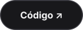</a>


</div>

<div align="center">

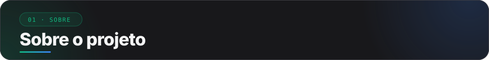

</div>

Acompanhe preço médio, proventos e meta de alocação, e simule novos aportes direto no navegador.

<div align="center">

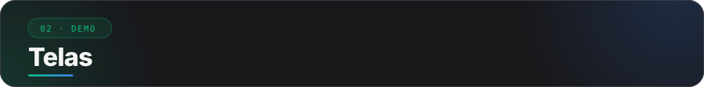

</div>

<div align="center">

<picture>
  <source media="(prefers-color-scheme: dark)" srcset="docs/assets/shot-painel-dark.svg" />
  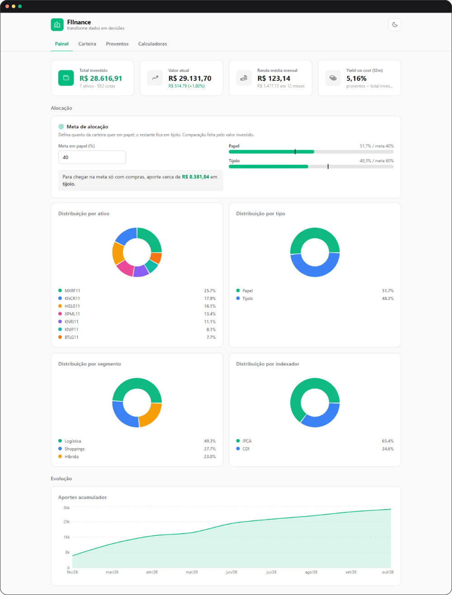
</picture>

<sub>Capturas com dados fictícios, só para demonstração.</sub>

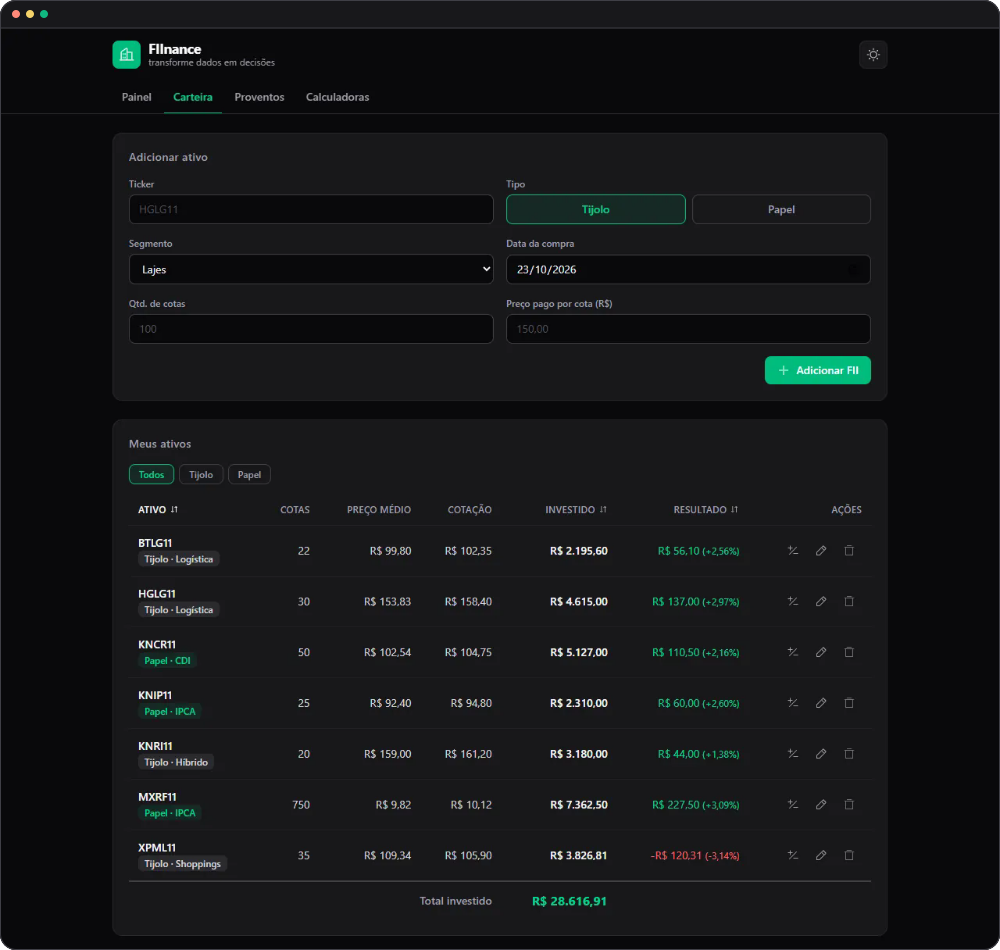
<br />
<sub><b>Carteira</b>: posição, cotação e resultado de cada fundo.</sub>

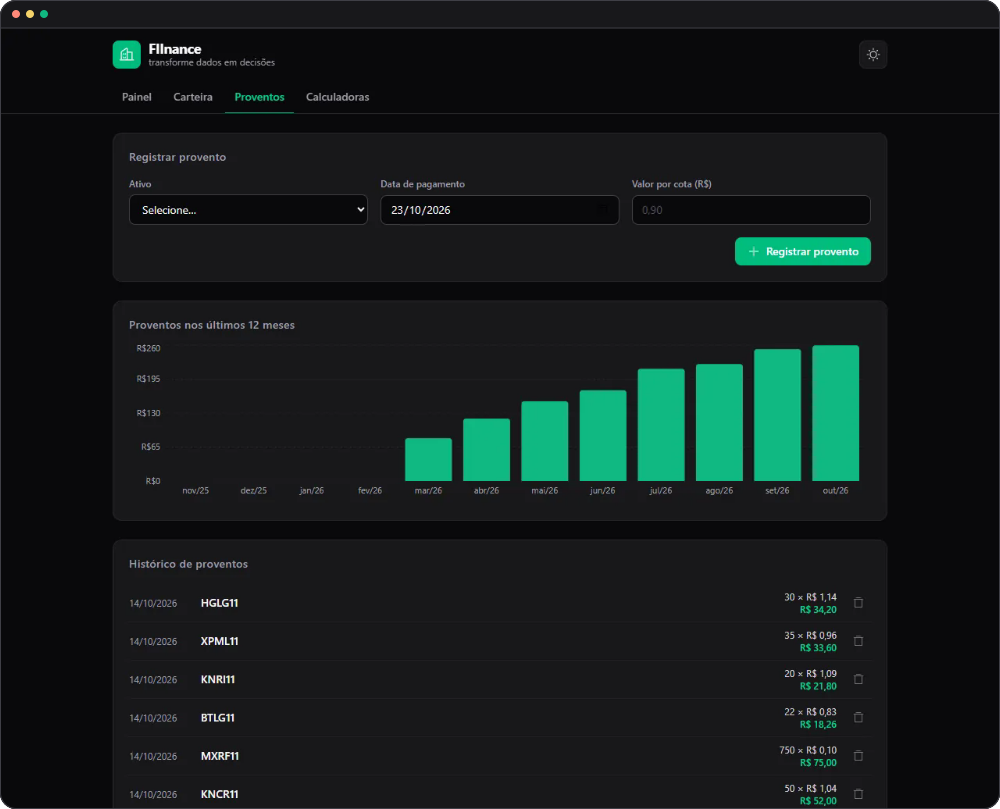
<br />
<sub><b>Proventos</b>: renda mensal e histórico de pagamentos.</sub>

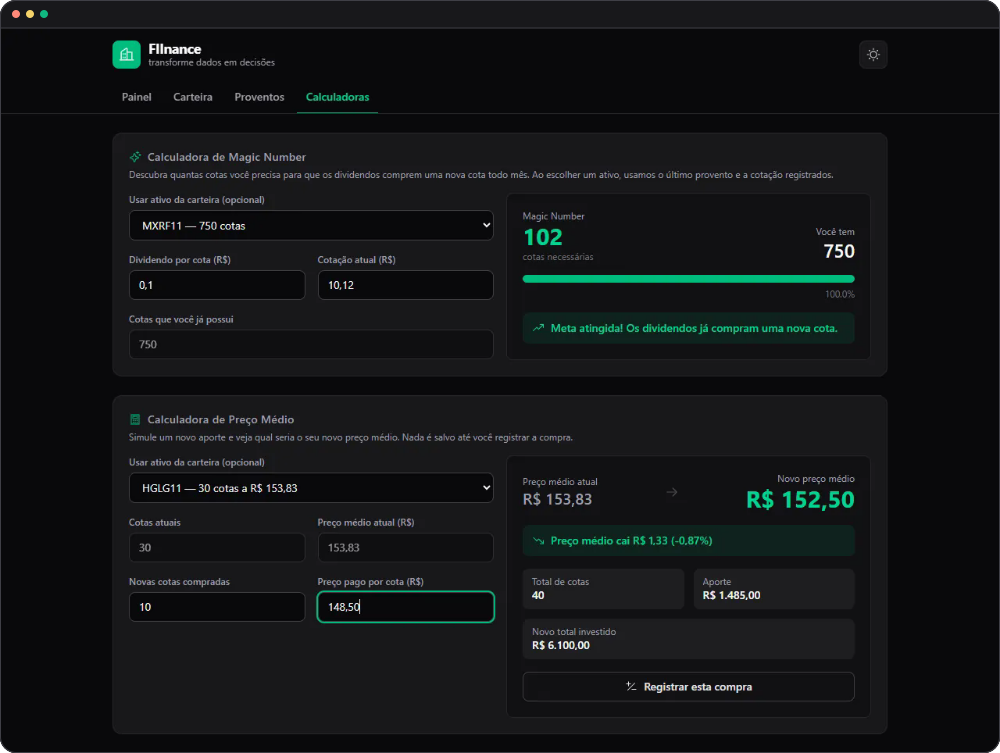
<br />
<sub><b>Calculadoras</b>: Magic Number e novo preço médio.</sub>

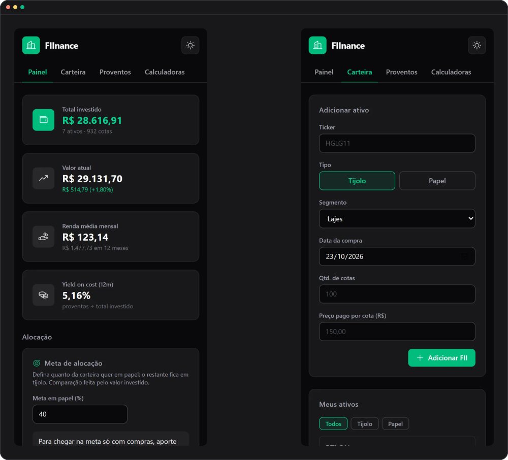
<br />
<sub><b>No celular</b>: o layout se adapta à tela.</sub>

</div>

<div align="center">

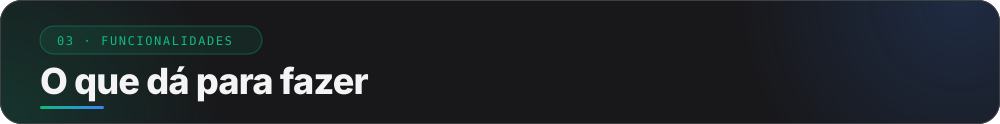

</div>

<div align="center">

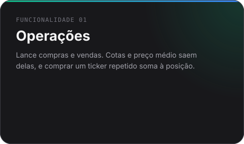 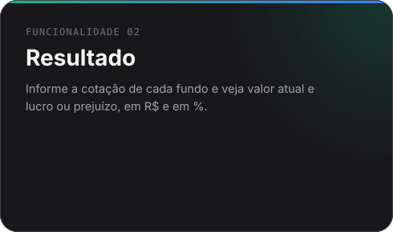
<br />
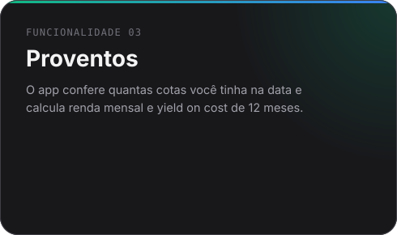 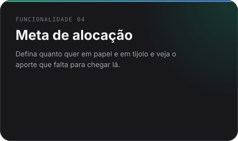
<br />
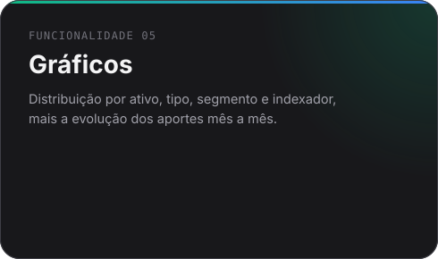 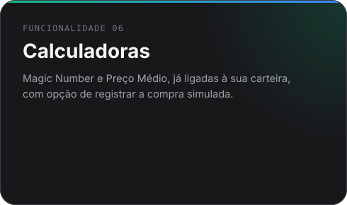
<br />
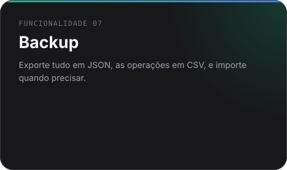 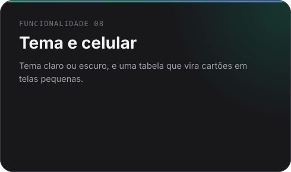

</div>

<div align="center">

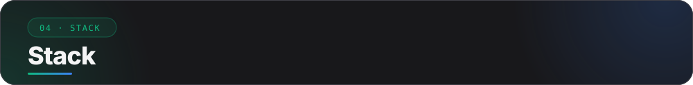

</div>

<div align="center">

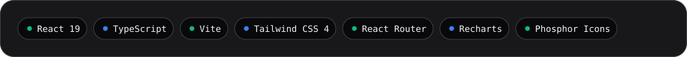

</div>

<div align="center">

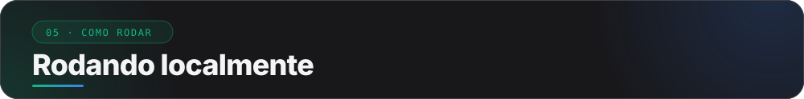

</div>

Requer [Node.js](https://nodejs.org) e [pnpm](https://pnpm.io).

```bash
git clone https://github.com/diegonatalo/FIInance.git
cd FIInance
pnpm install
pnpm dev        # http://localhost:5173
```

| Comando | O que faz |
|---|---|
| `pnpm dev` | Servidor de desenvolvimento com HMR, também acessível pela rede local (`--host`) |
| `pnpm build` | Checa os tipos e gera o build de produção em `dist/` |
| `pnpm preview` | Serve o build de produção |
| `pnpm lint` | Roda o ESLint |

### 🔑 Variáveis de ambiente

Há uma só, usada apenas no build. O modelo está em [`.env.example`](.env.example).

| Variável | Descrição | Se não for definida |
|---|---|---|
| `VITE_SITE_URL` | URL pública do site, sem barra final. | `robots.txt` sai sem a linha `Sitemap`, e o `sitemap.xml` não é gerado. |

No repositório, `.env.production` já aponta para `https://fiinance1.vercel.app`.

<div align="center">

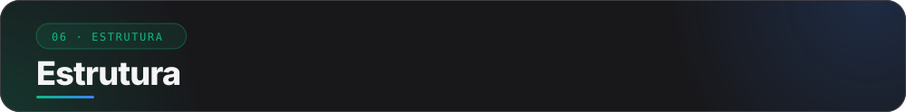

</div>

```text
src/
├── models/       tipos do domínio: Ativo, Transacao, Provento, Dados
├── lib/          lógica pura, sem React: posição, resumo, proventos, metas,
│                 calculadoras, validação e migração dos dados, exportação
├── hooks/        useCarteira (estado e ações), useLocalStorage, useTheme
├── contexts/     CarteiraProvider e ToastProvider
├── components/   interface (ui/: Button, Card, Modal, Field, Input)
└── pages/        uma tela por rota: Painel, Carteira, Proventos, Calculadoras e 404
```

> [!NOTE]
> A lógica de negócio fica em `lib/`, sem dependência de React. Os componentes só chamam essas funções.

<details>
<summary><b>Como adicionar uma página nova</b></summary>

<br />

1. Crie `src/pages/nome-page.tsx` exportando o componente da tela.
2. Registre a rota em `src/App.tsx`, dentro do `<Route element={<Layout />}>`.
3. Inclua o item em `navItems`, no `src/layout.tsx`, para aparecer no menu.
4. Adicione o caminho em `ROTAS`, no `vite.config.ts`, para entrar no `sitemap.xml`.

</details>

<div align="center">

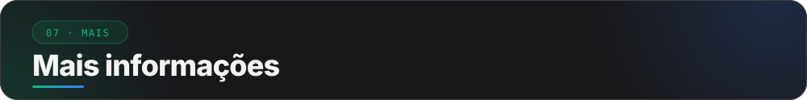

</div>

### 🔒 Seus dados ficam com você

Não há servidor nem conta. Tudo é salvo no `localStorage` do navegador, na chave `fiinance:dados`.

Limpar os dados do navegador apaga a carteira, então use **Carteira → Backup dos dados** de vez em quando.
Ao ler, o app valida o conteúdo, e um backup corrompido não derruba a tela.

Para buscar cotações, o app consulta a [brapi](https://brapi.dev), que exige um token para FIIs.
Sem ele a API responde 401, e dá para digitar a cotação à mão. O token fica só no navegador e não entra no backup.

### 🧠 Como os cálculos funcionam

O app guarda **operações**, e a posição de cada fundo é sempre derivada delas.

| Conceito | Regra |
|---|---|
| **Compra** | Soma as cotas e recalcula o preço médio ponderado. |
| **Venda** | Reduz as cotas e mantém o preço médio. Não deixa vender mais do que havia na data. |
| **Provento** | `valor por cota × cotas em carteira na data do pagamento`. |
| **Yield on cost (12m)** | Proventos dos últimos 12 meses ÷ total investido. |
| **Magic Number** | `⌈cotação ÷ dividendo por cota⌉`: cotas para os dividendos comprarem uma nova por mês. |
| **Aporte para a meta** | Menor compra em uma só classe que leva à proporção desejada: `(A + x) / (T + x) = alvo`. |

> Os valores servem para acompanhamento e não substituem a nota de corretagem nem o informe de
> rendimentos. O app não calcula imposto de renda.

### 🌐 Deploy

O app é publicado na [Vercel](https://vercel.com). O `vercel.json` redireciona qualquer rota para o
`index.html`, porque o app usa `BrowserRouter`. Em outro host, configure o mesmo *SPA fallback*;
sem ele, atualizar a página em `/carteira` retorna 404.

Ao mudar de domínio, atualize `VITE_SITE_URL` em `.env.production`. É ela que gera o `sitemap.xml`,
o `robots.txt` e as URLs absolutas de `og:image` e `twitter:image` usadas nos previews de links.

### 🧭 Próximos passos

- [ ] Testes automatizados e CI, que ainda não existem.
- [ ] Importar cotações e proventos sem token, o que pede um proxy próprio por causa do CORS.
- [ ] Lucro realizado e imposto de renda sobre vendas.
- [ ] Paginação do histórico de operações e de proventos, que cresce com o tempo.
- [ ] Sincronização entre dispositivos. Hoje o caminho é o backup em JSON.

### 🙏 Créditos

Ícones do [Phosphor Icons](https://phosphoricons.com), gráficos com [Recharts](https://recharts.org)
e cotações opcionais pela [brapi](https://brapi.dev).

<div align="center">

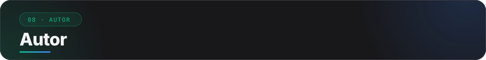

</div>

<div align="center">

<a href="https://diegonatalo.dev"></a>
<a href="https://www.linkedin.com/in/diegonatalo/">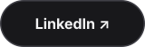</a>
<a href="https://github.com/diegonatalo">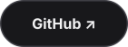</a>

</div>

<div align="center">


<sub>Feito com 💚 para quem investe em FIIs.</sub>

</div>
